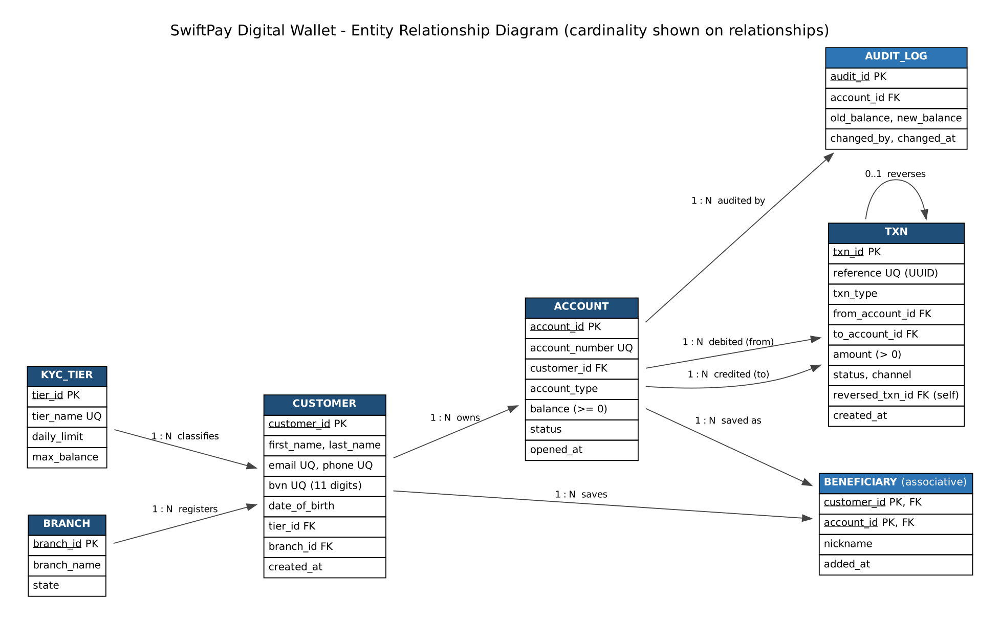

# Portfolio 1: Database Design and Modelling

## 1. Case study: SwiftPay Digital Wallet (simulated)

| Item | Description |
|---|---|
| **Organisation** | SwiftPay: a simulated Nigerian fintech that runs a mobile wallet and simple banking accounts |
| **Nature of business** | Customers open wallet, savings and current accounts. They deposit and withdraw cash and send money to each other through the app, USSD, POS agents or the web. |
| **Database users** | Customers (through the app), customer-service staff, compliance/audit officers, finance analysts and system administrators |
| **Major data stored** | Customers (with BVN and KYC tier), branches, accounts and balances, the transaction ledger, saved beneficiaries and a balance audit trail |
| **Key operations** | Open an account, deposit, withdraw, transfer funds, reverse failed transactions, view a statement, audit balance changes, report on transaction volumes |

## 2. ER diagram



The source is in `er_diagram.dot` (Graphviz). You can regenerate it with `dot -Tpng er_diagram.dot -o er_diagram.png`.

## 3. Relational schema (underline = PK, * = FK)

- **KYC_TIER**(<u>tier_id</u>, tier_name, daily_limit, max_balance)
- **BRANCH**(<u>branch_id</u>, branch_name, state)
- **CUSTOMER**(<u>customer_id</u>, first_name, last_name, email, phone, bvn, date_of_birth, tier_id*, branch_id*, created_at)
- **ACCOUNT**(<u>account_id</u>, account_number, customer_id*, account_type, balance, status, opened_at)
- **TXN**(<u>txn_id</u>, reference, txn_type, from_account_id*, to_account_id*, amount, status, channel, reversed_txn_id*, created_at)
- **BENEFICIARY**(<u>customer_id*, account_id*</u>, nickname, added_at)
- **AUDIT_LOG**(<u>audit_id</u>, account_id*, old_balance, new_balance, changed_by, changed_at)

The full DDL is in [`01_schema.sql`](01_schema.sql).

## 4. Keys and constraints

| Type | Where | Purpose |
|---|---|---|
| Primary keys | Surrogate `SERIAL`/`BIGSERIAL` on every entity; composite PK on `beneficiary` | Stable identity that doesn't depend on business data that can change |
| Candidate (UNIQUE) keys | `email`, `phone`, `bvn`, `account_number`, `txn.reference` | Enforce real-world uniqueness. `reference` is the idempotency key for a payment. |
| Foreign keys | customer→tier/branch, account→customer, txn→account (×2), txn→txn (reversal) | Referential integrity. `ON DELETE RESTRICT` on accounts so a customer who has money can't be deleted. |
| CHECK | `balance >= 0`, `amount > 0`, BVN regex `^[0-9]{11}$`, age ≥ 18, enumerated `status`/`txn_type`/`channel` | Business rules live in the database, not only in application code |
| Table-level CHECK `chk_txn_accounts` | `txn` | A DEPOSIT has only a destination, a WITHDRAWAL only a source, and a TRANSFER needs two *different* accounts |
| Trigger | `audit_balance` on `account` | Every balance change is logged automatically for compliance |

**Evidence:** [`constraint_tests.txt`](constraint_tests.txt) shows five invalid operations that the DBMS rejected: a negative balance, a bad BVN, a self-transfer, an orphan FK and a duplicate email.

## 5. Normalisation

**Starting point (un-normalised view).** A paper "transaction slip" would hold: customer name, phone, BVN, tier name, tier limit, branch name, branch state, account number, account type, balance, amount, date, and the beneficiary's name and account.

- **1NF.** Each attribute is atomic: the name is split into first and last, and repeating beneficiaries move to their own table. Each row is identified by a key.
- **2NF.** No partial dependencies. The only composite key is `beneficiary(customer_id, account_id)`, and its non-key attributes (`nickname`, `added_at`) depend on the *whole* key.
- **3NF.** Transitive dependencies are removed:
  - `customer_id → tier_id → daily_limit, max_balance`, so the limits move into `KYC_TIER`.
  - `customer_id → branch_id → branch_name, state`, so these move into `BRANCH`.
  - `txn_id → from_account_id → customer_id`, so the customer is *not* stored on `TXN`. It is derived through `ACCOUNT`.
- **BCNF.** Every determinant is a candidate key. For example, `bvn → customer_id` holds, and `bvn` is itself UNIQUE (a candidate key).

**Deliberate design decision.** `account.balance` is stored even though it could in theory be derived as SUM(credits) − SUM(debits) from `TXN`. This is controlled redundancy. Working out the balance from 300k+ ledger rows on every transfer would be too slow, and the balance is the row we lock during a transfer (see Portfolio 3). It stays consistent because it is only changed inside ACID transactions, and the `audit_log` trigger records every change.

## 6. How to run

```bash
createdb swiftpay
psql -d swiftpay -f 01_schema.sql
psql -d swiftpay -f 02_seed_data.sql     # ~5 s; 5 000 customers, 8 750 accounts, 300 000 transactions
```

Row counts after loading are in [`row_counts.txt`](row_counts.txt).
