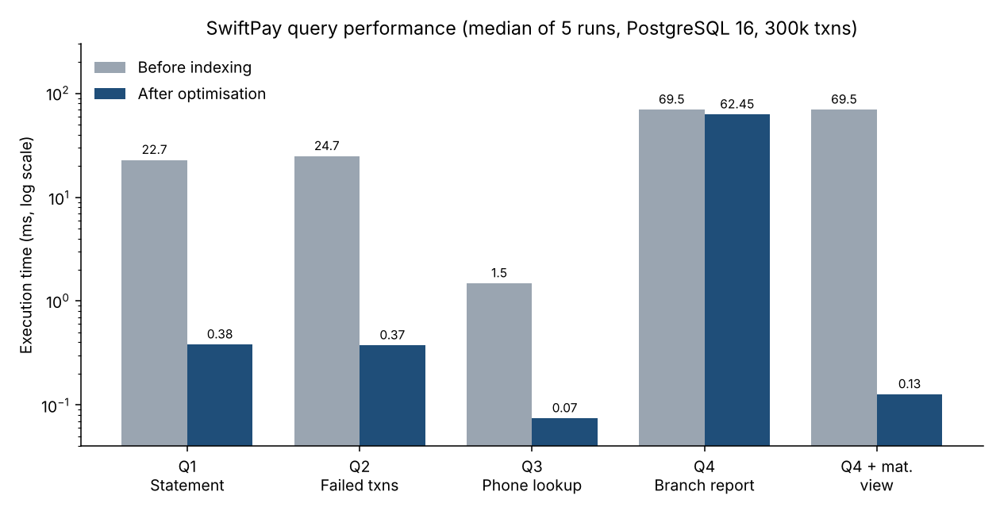

# Portfolio 2: Query Processing and Optimisation

**Environment:** PostgreSQL 16.15. Data set from Portfolio 1: 300 000 transactions, 8 750 accounts, 5 000 customers.
**Method:** each query was run 5 times with `EXPLAIN (ANALYZE, BUFFERS)` on a warm cache, and the median is reported. Everything is automated in [`run_benchmark.sh`](run_benchmark.sh).

## 1. Queries ([`queries.sql`](queries.sql))

| # | Business purpose | SQL feature |
|---|---|---|
| Q1 | Account statement: last 20 transactions for one account | `OR` across two columns, `ORDER BY … LIMIT` |
| Q2 | Failed transactions in the last 7 days (for the reversal job) | Selective filter on a skewed column |
| Q3 | USSD login: customer lookup by phone | Join with an equality filter |
| Q4 | Monthly transfer value per branch, last 6 months | 4-table join, `GROUP BY`, aggregation |

Sample output is in [`q1_sample_output.txt`](q1_sample_output.txt) and [`q4_sample_output.txt`](q4_sample_output.txt).

## 2. Results



| Query | Before (ms) | After (ms) | Speed-up | Plan before → after |
|---|---|---|---|---|
| Q1 | 22.73 | 0.380 | **60×** | Parallel Seq Scan → BitmapOr of two Bitmap Index Scans |
| Q2 | 24.74 | 0.373 | **66×** | Parallel Seq Scan → Bitmap Index Scan on a *partial* index |
| Q3 | 1.48 | 0.074 | **20×** | Seq Scan on `account` → Index Scan on `idx_account_customer` |
| Q4 | 69.45 | 62.45 | 1.1× | Seq Scan → **Index Only Scan** (Heap Fetches: 0), but the time is still spent in Sort and GroupAggregate |
| Q4 + MV | 69.45 | 0.126 | **~550×** | Seq Scan on a 56-row materialized view |

All plans are saved in [`plans/`](plans/) (`Qn_before.txt`, `Qn_after.txt`, `Q4_materialized_view.txt`).

## 3. Analysis

**Q1: indexes for an `OR`.** One index on `(from_account_id)` can't satisfy `from = X OR to = X`. Before indexing, the planner had to read all 300k rows with 3 parallel workers. With one composite index per column, `(from_account_id, created_at DESC)` and `(to_account_id, created_at DESC)`, PostgreSQL combines them with a **BitmapOr** and touches only ~50 rows. An alternative would be to rewrite the query as a `UNION ALL` of two `ORDER BY … LIMIT 20` sub-queries. That could skip the bitmap step entirely for very active accounts.

**Q2: partial index.** Only about 3% of transactions are `FAILED`. A full index on `status` would be large and rarely chosen. The partial index `ON txn(created_at) WHERE status = 'FAILED'` indexes about 9k rows instead of 300k, so it is small, cheap to maintain on INSERT, and exactly matches the reversal job's predicate.

**Q3: index foreign keys.** PostgreSQL does **not** index foreign-key columns automatically (unlike the UNIQUE constraint on `phone`, which already gave an index). The join to `account` therefore scanned all 8 750 rows. Indexing `account.customer_id` turned this into a nested-loop index lookup.

**Q4: why an index alone wasn't enough.** The covering index `(txn_type, status, created_at) INCLUDE (from_account_id, amount)` worked as designed. The plan shows an **Index Only Scan with 0 heap fetches**, and the scan dropped to about 7 ms. But the query still has to join, sort and aggregate about 36 800 rows. About 85% of the time is in the hash joins, the Sort and the GroupAggregate, which no index removes. Because this is a management report that tolerates slightly stale data, I added a **materialized view** ([`materialized_view.sql`](materialized_view.sql)) with a unique index. That allows `REFRESH MATERIALIZED VIEW CONCURRENTLY` (readers aren't blocked during a refresh). The report then reads 56 pre-aggregated rows in about 0.13 ms.

*Trade-offs:* (1) the data is only as fresh as the last refresh; (2) the view uses whole calendar months, while the original query uses a rolling 6-month window; (3) each extra index on `txn` slows down INSERTs, which matters for a payment system. That is why I chose a partial index and a covering index rather than indexing every column.

## 4. How to reproduce

```bash
export PGHOST=/tmp PGUSER=postgres      # adjust to your server
./run_benchmark.sh                       # drops indexes, runs baseline, creates indexes, re-runs
psql -d swiftpay -f materialized_view.sql
```
